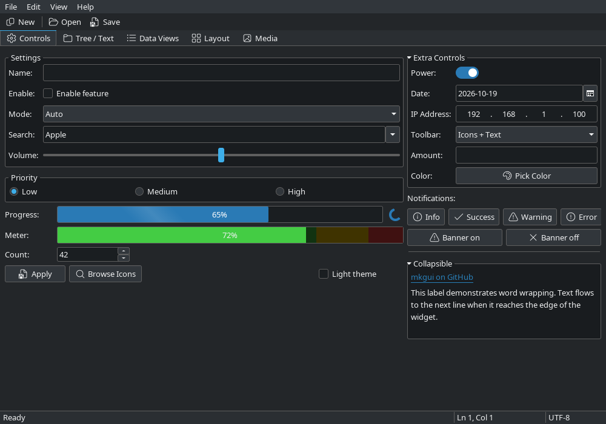
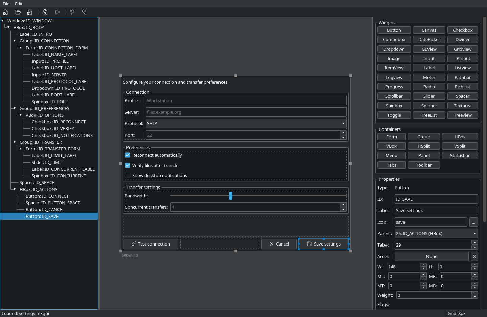

# mkgui

mkgui is a C99 GUI toolkit for Linux (X11) and Windows (Win32), with software rendering and a visual editor.

Applications include `mkgui.h` and link the toolkit shared library. The demo, editor, and editor-generated applications use this interface. A separate shared library supplies the same Fluent SVG icon catalogue on both platforms.

| Runtime library | Linux | Windows |
|---|---|---|
| Toolkit | `libmkgui.so.1.0.0` | `mkgui.dll` |
| Icon catalogue | `libmkguiicons.so.1` | `mkguiicons.dll` |

The toolkit contains its platform backend and SVG rasterizer. Applications do not link a separate mkwin or PlutoSVG library. Linux uses Xlib, Xext, FreeType, and Fontconfig; Windows uses system Win32/GDI APIs. OpenGL is used only by applications that create an OpenGL view.



## Build and run

From a source checkout:

```sh
git clone https://github.com/vtlmks/mkgui.git
cd mkgui
git checkout v1.0.0
git submodule update --init --recursive
./build.sh
out/linux/demo
out/linux/editor
```

The source build needs GCC, binutils, Bash, pkg-config, Python 3, and the Linux development packages listed in [getting started](documentation/getting_started.md#prerequisites). The demo also needs OpenGL development files. If the MinGW cross-compiler is installed, `build.sh` builds the Windows libraries and applications too.

Build outputs find their shared libraries in the output directory. No system installation is needed to try the demo or editor. `./build.sh library` builds the libraries; `./build.sh editor` builds the libraries and editor. Other targets and build modes are described in [getting started](documentation/getting_started.md#building-mkgui).

`mkwin/` is a pinned source submodule. After changing the checkout, run `git submodule update --init --recursive`. The Fluent icon sources are vendored as ordinary files.

## Use in an application

```c
#include "mkgui.h"
#include "mkguiicons_names.h"

enum { ID_WIN = 1, ID_BOX, ID_BTN, ID_LBL };

// [=]===^=[ on_event ]========================================================================[=]
static void on_event(struct mkgui_window *win, struct mkgui_event *ev, void *userdata) {
	(void)userdata;

	if(ev->type == MKGUI_EVENT_CLOSE) {
		mkgui_ctx_quit(mkgui_window_get_ctx(win));

	} else if(ev->type == MKGUI_EVENT_CLICK && ev->id == ID_BTN) {
		mkgui_label_set(win, ID_LBL, "Clicked!");

	}
}

// [=]===^=[ main ]============================================================================[=]
int main(void) {
	struct mkgui_widget widgets[] = {
		MKGUI_W(MKGUI_WINDOW, ID_WIN, "Hello", "", 0, 400, 300, 0, 0, 0),
		MKGUI_W(MKGUI_VBOX, ID_BOX, "", "", ID_WIN, 0, 0, 0, 0, 0),
		MKGUI_W(MKGUI_BUTTON, ID_BTN, "Click", MKICON_CHECKMARK, ID_BOX, 120, 0, MKGUI_FIXED, 0, 0),
		MKGUI_W(MKGUI_LABEL, ID_LBL, "Ready", "", ID_BOX, 0, 0, 0, 0, 0),
	};
	struct mkgui_ctx *ctx = mkgui_ctx_create();

	if(ctx) {
		struct mkgui_window *win = mkgui_window_create(ctx, NULL, widgets, sizeof(widgets) / sizeof(widgets[0]), NULL, 0, 0);

		if(win) {
			mkgui_ctx_run(ctx, on_event, NULL);
			mkgui_window_destroy(win);
			mkgui_ctx_destroy(ctx);
			return 0;

		}

		mkgui_ctx_destroy(ctx);

	}

	return 1;

}
```


Compile against the libraries in this checkout:

```sh
# Linux: executable and shared libraries in out/linux
gcc -std=c99 -O2 -Wall -Wextra myapp.c -I. -Lout/linux -lmkgui '-Wl,-rpath,$ORIGIN' -o out/linux/myapp

# Windows: executable and DLLs in out/windows
x86_64-w64-mingw32-gcc -std=c99 -O2 -Wall -Wextra myapp.c -I. -Lout/windows -lmkgui -mwindows -o out/windows/myapp.exe
```

For systemwide Linux installation, run `./install_icons.sh`, `./install.sh`, and `ldconfig` with the required filesystem permissions. Both installers default to `/usr` and support `PREFIX` and `DESTDIR`. Installed applications compile with `gcc myapp.c $(pkg-config --cflags --libs mkgui1.0.0) -o myapp`.

Windows applications ship `mkgui.dll` and `mkguiicons.dll` beside the executable. See [getting started](documentation/getting_started.md) for installation, native Windows builds, and optional static or source-inclusion builds.

## Widgets and editor

The toolkit provides buttons, text inputs, checkboxes, lists and trees, tables, tabs, menus, toolbars, sliders, spinboxes, images, custom canvases, and OpenGL child windows. Containers arrange widgets by parent ID, size hints, and weight. Built-in dialogs cover files, messages, text input, colours, and icon selection.

Other features include runtime scaling, themes, keyboard accelerators, text undo/redo, file drag-and-drop, and multiple windows. The [API guide](documentation/doc.md) describes widget setup and events.



The editor designs layouts using the same layout engine as the toolkit. It saves `.mkgui` projects and generates C source that links the shared library, plus a sibling feature-configuration header. It can also export widget-array snippets. See the [editor guide](documentation/editor.md).

## Icons

Both platforms use the Fluent SVG catalogue in `mkguiicons`. Widget definitions store names such as `MKICON_SAVE` from `mkguiicons_names.h`. The editor browses the same catalogue. Applications need no desktop icon theme, exported icon list, or per-application SVG directory.

SVGs are rasterized at the requested pixel dimensions, including fractional scales. Monochrome icons follow the theme text colour; colour icons retain their colours. Custom SVG files and pixel icons can also be registered. The independent [icon API](documentation/icons.md) provides name enumeration, search metadata, size variants, and SVG lookup.

## Versions

**1.0.0 is the first stable library release.** Choose a release tag for an application and stay on it. Other tags may change the API or ABI; updating is an explicit porting decision. Each full release has its own Linux SONAME, headers, static archive, and pkg-config package, so applications built against different releases can coexist on the same machine, including releases with the same major number. Windows applications carry their matching DLLs beside the executable.

For example, `pkg-config --cflags --libs mkgui1.0.0` selects the 1.0.0 headers and library. The executable records `libmkgui.so.1.0.0` and continues loading that release when others are installed.

`master` is the development branch. Use a published release tag for a fixed source snapshot, and initialize its pinned mkwin submodule. The icon catalogue has its own version and ABI; compatible catalogue updates serve multiple toolkit versions. See [the changelog](CHANGELOG.md) and [migration from beta releases](documentation/migration_v1.0.0.md).

## Documentation

- [Build, install, and link](documentation/getting_started.md)
- [API and widget guide](documentation/doc.md)
- [Visual editor](documentation/editor.md)
- [Icons and enumeration](documentation/icons.md)
- [Layout rules](documentation/layout.md)
- [Benchmark commands and timing fields](documentation/benchmark.md)
- [Internal architecture](documentation/architecture.md)
- [Adding widgets](documentation/adding_widgets.md)

## Limitations and contributions

Text rendering covers Latin-1 glyphs without complex shaping or right-to-left layout. There is no accessibility API integration.

This is a solo project. Bug reports with a reproducer are welcome through issues; fixes are applied in-house rather than through pull requests. Security reports are described in [SECURITY.md](SECURITY.md).

## License

MIT. See [LICENSE](LICENSE).
